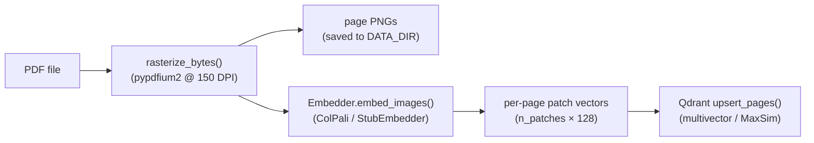

# facsimile — Architecture Dossier

## Overview

`facsimile` is a visual document RAG system that retrieves over PDF pages as
images using late-interaction visual embeddings (ColPali / ColQwen2-style).
Unlike text-based RAG, it never extracts text: the rendered page image is the
atomic unit from ingestion through to synthesis, so tables, charts, and form
layouts survive intact.

**Problem being solved.** Text extraction destroys the visual structure of
business documents. A table whose meaning is in its grid layout, or a bar
chart whose data is in pixel positions, becomes garbled text. `facsimile`
sidesteps the extraction step entirely and retrieves at the visual patch level.

---

## Component map

```
facsimile/
  ingest/
    rasterize.py   # PDF → PIL Images (pypdfium2)
    embed.py       # Embedder protocol + StubEmbedder / ColPali / ColQwen wrappers
    pipeline.py    # ingest_pdf, ingest_and_store — single-call PDF → store
  index/
    store.py       # Qdrant multivector collection: PageRecord, upsert, query
  retrieve/
    retriever.py   # Retriever class: text query → MaxSim → RetrievedPage list
  answer/
    synthesizer.py # synthesize(): page images → Claude vision → Answer
  bench/
    questions.py   # BenchQuestion dataclass + JSON loader
    text_pipeline.py  # keyword-overlap baseline (pypdfium2 text extraction)
    runner.py      # run_benchmark(), summarize_results() → BenchSummary
  api/
    main.py        # FastAPI app: /ingest /retrieve /ask /pages /viewer
  viewer/
    app.py         # viewer_html() — dark-mode HTML SPA
```

---

## Data and control flow

### Ingest flow



1. `POST /ingest` receives raw PDF bytes.
2. `rasterize_bytes()` decodes the PDF via `pypdfium2` at 150 DPI and returns a
   `list[PIL.Image]`, one per page.
3. Page PNGs are written to `{DATA_DIR}/{doc_id}/page_NNNN.png` so they can be
   served later by `GET /pages/{doc_id}/{page_num}`.
4. `Embedder.embed_images()` turns each image into a matrix of patch-level
   vectors `(n_patches, 128)`. The real implementation uses ColPali or ColQwen2;
   `StubEmbedder` emits deterministic random vectors for tests.
5. `upsert_pages()` stores each page as a Qdrant point whose `vector` field is
   the full patch matrix. The point ID is a SHA-256 hash of `(doc_id, page_num)`,
   so re-ingesting overwrites the same points. `delete_other_pages()` then
   removes any other point stored for that `doc_id`, so a document that lost
   pages does not keep them in the index.

### Query flow


1. `Retriever.retrieve(query)` calls `Embedder.embed_queries([query])` to get a
   query-side patch matrix.
2. Qdrant's `MAX_SIM` comparator scores each indexed page via the MaxSim
   operator: for each query patch, find the maximum cosine similarity over all
   page patches, then sum across query patches. This is ColPali's late-interaction
   scoring, executed inside the ANN index in a single network call.
3. The top-k `RetrievedPage` objects (with `doc_id`, `page_num`, `score`) are
   returned to the caller.
4. `POST /ask` loads the corresponding PNGs from disk, builds an interleaved
   image+text message for the Claude vision API, and calls `synthesize()`.
5. `synthesize()` prompts the model to emit `[Page N]` citation markers, then
   extracts them with a regex and returns an `Answer(text, cited_pages, model)`.

---

## Key design decisions and trade-offs

### Page image as the atomic unit

Every module operates on whole page images, never on extracted text. This is the
central invariant. It means:

- Tables and charts are never flattened to text at any stage.
- The rasterized PNG is the canonical representation; text extraction is only used
  in the text-pipeline benchmark baseline, not in the main retrieval path.

Trade-off: per-page storage and embedding are heavier than text. A 150-DPI PNG
for a standard letter page is roughly 300–600 KB before any ML inference. Real
ColPali/ColQwen inference requires a GPU for practical throughput.

### Late-interaction scoring (MaxSim)

ColPali-style embedding produces a matrix of patch vectors per page rather than
a single vector. At query time, each query token is compared against every page
patch, and the maximum similarity is accumulated — this is the MaxSim operator.

`facsimile` delegates MaxSim to Qdrant's native `MultiVectorConfig(comparator=MAX_SIM)`
rather than implementing it in Python. This means:

- Retrieval is a single Qdrant `query_points` call, not a Python loop.
- The ANN index respects the multivector structure — approximate search is over
  pages, not over individual patches.

Trade-off: every page's patch matrix must fit in a single Qdrant point. Very
high-resolution renders produce larger matrices, which increases memory and index
size proportionally.

### Embedder protocol

The `Embedder` protocol (`embed_images`, `embed_queries`) decouples retrieval
from any specific model. The three implementations share the same interface:

| Embedder | Use case |
|---|---|
| `StubEmbedder` | Tests and CI — no model download, deterministic |
| `ColPaliEmbedder` | ColPali v1.2 from Hugging Face (`facsimile[embed]`) |
| `ColQwenEmbedder` | ColQwen2 v1.0 from Hugging Face (`facsimile[embed]`) |

The API server defaults to `StubEmbedder` at startup; swap via environment or
direct construction to use a real model.

### Vision-LLM synthesis

`synthesize()` is intentionally thin: it builds an interleaved content block
(text label → image → next page) and sends it to Claude with a single system
prompt. Citation extraction uses a regex (`[Page N]`) rather than structured
output — this keeps the API surface simple and lets the model's reasoning flow
naturally without forcing JSON formatting.

### Point ID stability

Qdrant point IDs are unsigned 64-bit integers or UUIDs. `_page_id(doc_id, page_num)`
takes the first 8 bytes of a SHA-256 hash of `[doc_id, page_num]`, so the same page
gets the same ID in every process and re-ingesting overwrites the existing point.

Up to 6 October 2026 the ID came from Python's `hash()`. Python salts string
hashes per process, so after a restart every re-ingest into a persistent Qdrant
added a second copy of each page, and the top results filled up with duplicates.
`ingest_and_store()` now upserts the new pages and then calls
`delete_other_pages()`, which deletes every point for that `doc_id` that is not
one of the new page IDs. That also clears duplicates left by the old scheme the
first time a document is re-ingested. The test suite pins one ID value, because
changing the scheme again would orphan every stored point.

### Application state

`api/main.py` holds a module-level `_State` instance wired up during the FastAPI
lifespan event. Tests inject an in-memory Qdrant client and `StubEmbedder`
directly via `_state.initialise()`, avoiding any real network calls or ML
inference.

---

## External dependencies

| Dependency | Role |
|---|---|
| `pypdfium2` | PDF decoding and rasterization (and text extraction for the baseline) |
| `Pillow` | Image handling throughout the pipeline |
| `qdrant-client` | Multivector ANN index with MaxSim comparator |
| `anthropic` | Claude vision API for synthesis |
| `fastapi` + `uvicorn` | HTTP layer |
| `python-multipart` | File upload parsing for `POST /ingest` |
| `numpy` | Patch-vector arithmetic in embedders |
| `colpali-engine` + `torch` | Real ColPali/ColQwen2 inference (optional `[embed]` extra) |

---

## Where each spec milestone lives in the code

| Milestone | Spec outcome | Code |
|---|---|---|
| M0 — Scaffold | Rasterization, multivector store, CI | `ingest/rasterize.py`, `index/store.py`, `.github/workflows/ci.yml` |
| M1 — Visual embedding | Late-interaction page embeddings indexed | `ingest/embed.py`, `ingest/pipeline.py` |
| M2 — Retrieval | Late-interaction scoring, top-page selection | `retrieve/retriever.py`, `index/store.py:query_pages` |
| M3 — Vision synthesis | Vision-LLM answers over pages + citations | `answer/synthesizer.py` |
| M4 — Benchmark | Table/chart set, visual vs text numbers | `bench/questions.py`, `bench/text_pipeline.py`, `bench/runner.py` |
| M5 — Ship | Viewer with page highlight, FastAPI, README | `api/main.py`, `viewer/app.py` |

---

## Deployment topology

```
┌──────────┐   PDF upload   ┌─────────────────────┐   patch vectors   ┌────────────┐
│  client  │ ─────────────► │  FastAPI (uvicorn)  │ ────────────────► │  Qdrant    │
│ (browser │ ◄───────────── │  api/main.py        │ ◄──────────────── │  (local or │
│  / curl) │   answer+pages │                     │   scored pages    │   remote)  │
└──────────┘                └──────────┬──────────┘                   └────────────┘
                                       │  page images + question
                                       ▼
                               ┌───────────────┐
                               │  Claude API   │
                               │  (vision)     │
                               └───────────────┘
```

- **In-memory mode** (default): Qdrant runs inside the process; state is lost on
  restart. Good for development and demos.
- **Persistent mode**: set `QDRANT_URL` to point at a Qdrant server. State
  survives restarts; page PNGs still live on the local filesystem at `DATA_DIR`.
- **Viewer**: served as a static HTML string from `GET /viewer`; it calls
  `POST /ask` and `GET /pages/{doc_id}/{page_num}` directly, so no separate
  frontend build step is needed.

---

## Benchmark baseline

The text pipeline in `bench/text_pipeline.py` exists solely as a comparison
baseline. It extracts raw text from each PDF page via `pypdfium2`'s text layer
and ranks pages by keyword overlap (fraction of distinct query terms that appear
on the page). This is intentionally naïve — it represents the approach most
commodity text RAG systems use — so any accuracy gap against the visual pipeline
is attributable to visual understanding, not to search sophistication.
